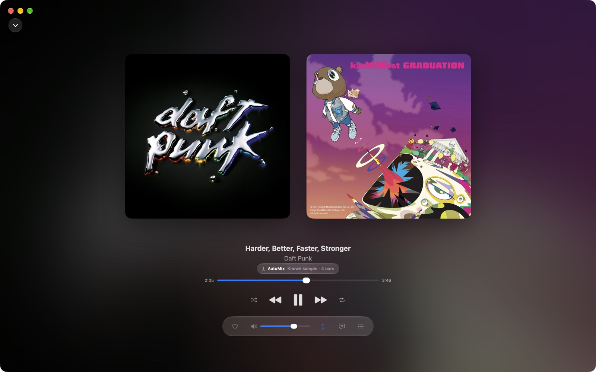
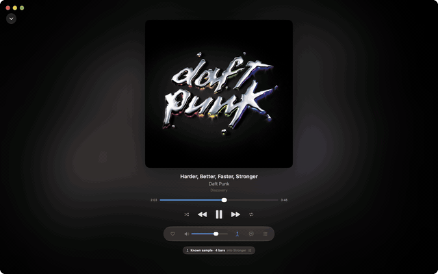
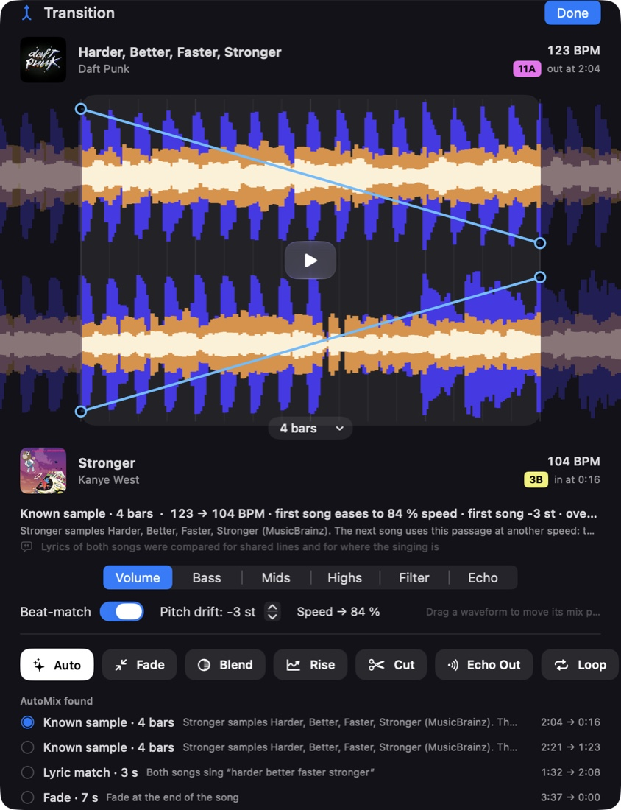
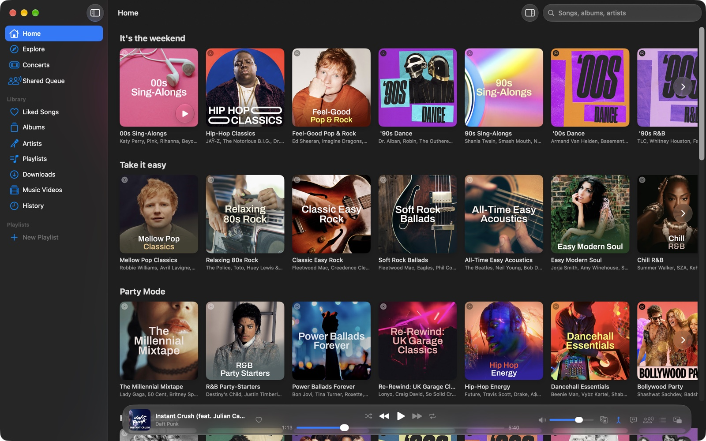
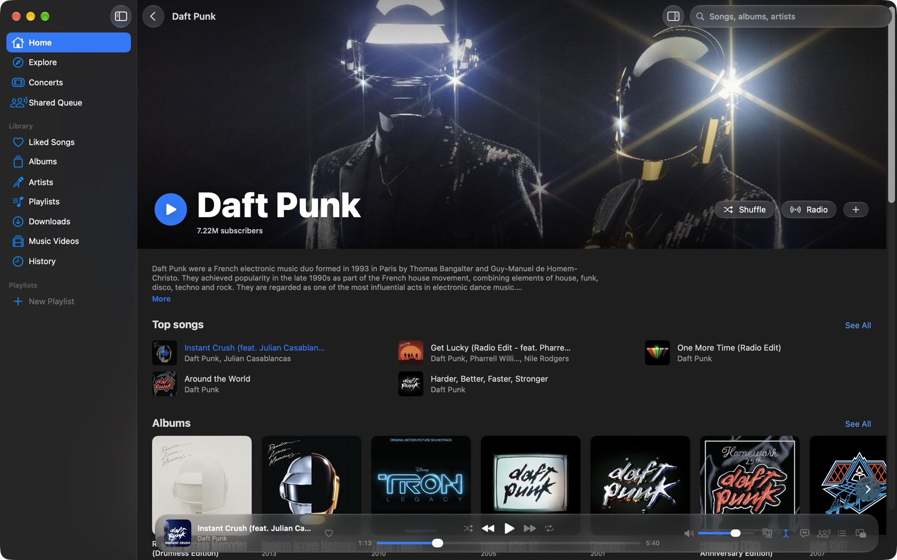
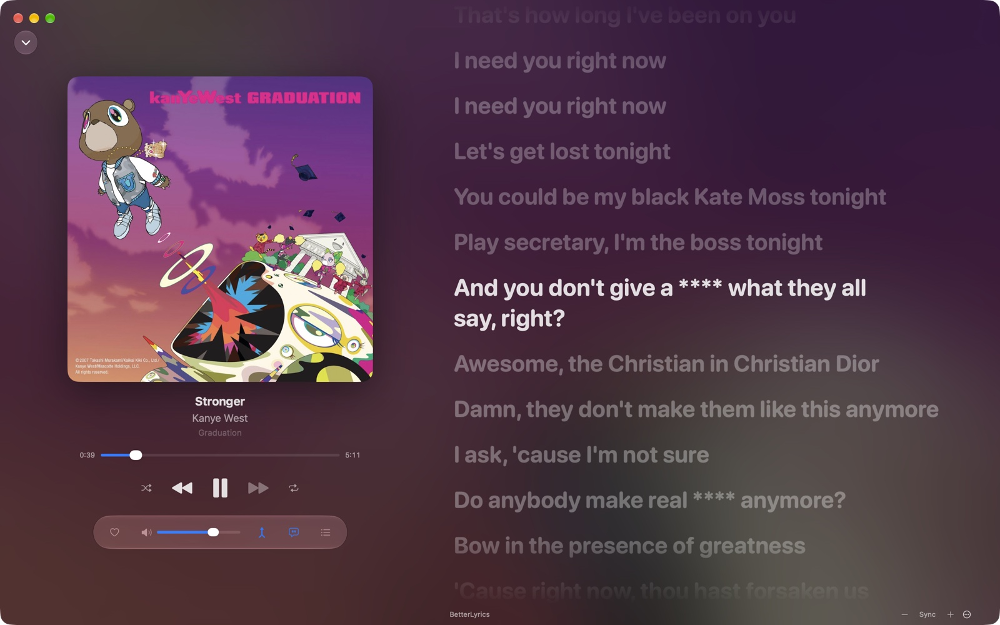
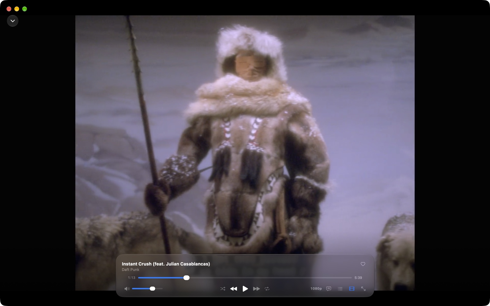
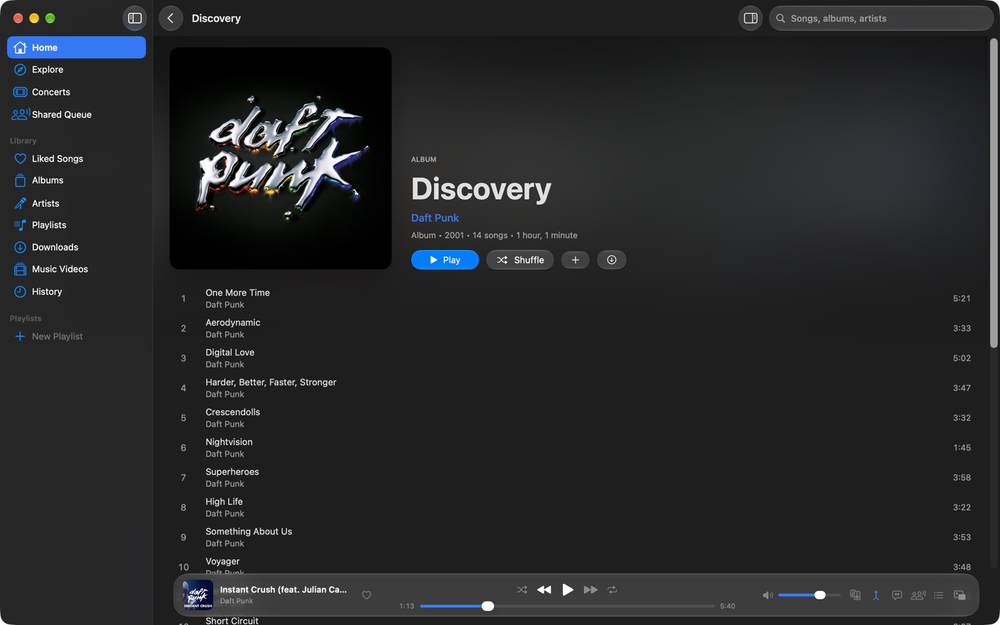
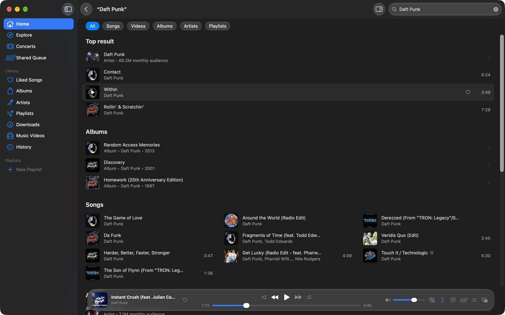

<div align="center">


<h1>YouTube Music with AutoMix</h1>

**A native macOS YouTube Music client that mixes songs the way a DJ does.**<br/>
It tracks beats, finds samples and separates stems on your Mac, matches the beats between songs,<br/>
and adds bit-perfect output, synced lyrics and a music-video player, in SwiftUI with Liquid Glass.

<br/>


<br/>



<sub>Harder, Better, Faster, Stronger mixing into Stronger. AutoMix found the sample, slowed Daft Punk to 84 % speed and three semitones lower, and brought Kanye in on the bar.</sub>

</div>

---

## Overview

This is a complete YouTube Music app for the Mac, written from scratch in Swift. It follows the
design of the Android client [Metrolist](https://github.com/MetrolistGroup/Metrolist), so the
application is currently named Metrolist on macOS. It is one Swift package and uses only
Apple's frameworks, with no third-party dependencies.

Its main feature is AutoMix. Instead of a crossfade, AutoMix plans a transition for every pair of
songs. It analyses each song on your Mac for tempo, beats and bars, key, harmony, sections and
where the singing is, then looks for the point where the two songs fit. The result can be a
blend between phrases with the beats matched, a hand-over on words both songs sing, a dissolve
between passages that sound alike, or the record the next song samples, brought up to the right
speed. It can split both songs into vocals, drums and bass during the transition, so one singer
stops before the other starts and the basslines swap halfway. The app shows and explains every
transition, and you can edit any of them.

Other features include: bit-perfect output to a DAC, word-synced lyrics, romaji support for
Japanese, Chinese and Korean, a full-screen music-video player that plays up to 4K,
Apple Music's animated covers, concerts near a place you choose, scrobbling, and a shared queue
that friends can add to from the Metrolist mobile application (v14.0 and onwards).

---

## AutoMix

<div align="center">

</div>

When a transition begins, the next song's cover slides in beside the playing one, and the
background blends the colours of both covers. Half-way through, the next song takes over. The old
cover slides away and the new one moves to the centre. The controls stay where they are.

### How AutoMix plans a transition

1. **It analyses each song once.** The app measures each cached song on the Mac. It finds the
   tempo, a beat grid and bar lines, the key, the harmony of every beat as chroma, the tone
   colour, the band levels, the section boundaries and a three-band waveform. A small neural beat
   tracker, [Beat This!](https://github.com/CPJKU/beat_this) from
   [ISMIR 2024](https://doi.org/10.5281/zenodo.14877491), runs through Core ML. It catches the
   songs where the classic tracker counts the wrong pulse, which happens often in fast J-pop and
   vocaloid.
2. **It looks for a reason to mix.** For each pair the planner searches both songs for the
   following kinds of transition.
   - A **Mix** or **Blend** overlaps the songs between phrase boundaries with the beats matched.
     The planner scores each one for lost material, clashing vocals, key and energy.
   - A **Lyric match** hands over on a line both songs sing, when the lyrics have word timing.
   - A **Sound match** dissolves between passages whose harmony and tone colour agree.
   - A **Known sample** or **Sample match** follows the next song's sample of the playing one at
     its real speed and pitch. Good Life uses P.Y.T. at 67 % speed, yet higher in pitch. Sample
     links come from MusicBrainz, and from Genius if you add a token. When no link is documented,
     a learned sample gate decides whether the songs really share material. The gate is a
     logistic model on six measurements of the match.
   - A **Tempo match** or **tempo ramp** moves the playing song to the next one's tempo when the
     two are 12 to 20 % apart.
   - A **Fade** is the fallback. When nothing lines up, a clean fade sounds better than a forced
     mix.
3. **It changes tempo and key before the overlap, never during it.** The playing song moves to
   the new tempo and key over 12 to 32 seconds before the transition, the way a DJ adjusts the
   pitch fader before bringing in the next record. Then both songs run beat for beat. The engine
   starts the incoming deck at an exact time on the audio clock, and a phase lock adjusts its speed
   to keep the beats together. A Tempo match between unrelated songs may change speed by at most
   20 % and pitch by at most two semitones, the range real DJs almost always stay within. A tempo
   ramp can speed a song up by as much as 25 %, and songs that share a sample can go further.
4. **It separates the stems, if you switch that on.** With "Mix with stems" on, HT-Demucs from
   [ICASSP 2023](https://doi.org/10.1109/ICASSP49357.2023.10096956) runs through Core ML. As soon
   as the planner decides a transition, the app splits the two overlapping passages into vocals,
   drums, bass and the rest. It follows the stem rules of
   [Mosaikbox](https://doi.org/10.5281/zenodo.14877463). The outgoing vocals stop on the beat
   before the incoming vocals start, the basslines swap halfway, and in blends the drums hand
   over.
5. **It orders the queue.** AutoMix re-orders the songs Autoplay lines up so each one mixes well
   out of the one before. The weights come from 501 transitions in 28 DJ-made sequences.

The parts meet in one object, the mix plan. Analysis describes each song once, when the app caches
it. When a song comes up next, the planner reads both songs' analyses, their lyrics and the sample
database, lets the sample gate and the tempo limit rule out what doesn't fit, and picks a plan.
With stems on, the separator processes the overlap straight away. Shortly before the mix point the
player hands the plan to the engine, which performs it, and the editor and the full-screen player
show that same plan. The [AutoMix paper](docs/paper/automix-paper.pdf) explains each part, how
they were tested, and what AutoMix can't do yet.

### The transition editor

<div align="center">

</div>

Hold the AutoMix button, or press ⌥⌘E, to open the transition editor. Drag a waveform to move its
mix point. Drag the curves for volume, bass, mids, highs, filter and echo. Try a preset, which can
be Fade, Blend, Rise, Cut, Echo Out or Loop, or pick one of AutoMix's other proposals. Each
proposal says why the planner chose it. In this example AutoMix found that Stronger samples
Harder, Better, Faster, Stronger, and it also offers a hand-over on the line both songs sing.

### How AutoMix is measured

AutoMix is checked against what DJs and streaming services do in practice. The test sets are
DJ-mixed albums, Spotify's "Mixed By" playlists, curated sample pairs and published research on
20,765 DJ transitions by [Kim et al. at ISMIR 2020](https://doi.org/10.5281/zenodo.4245544). The
beat model, the sample gate and the queue order were trained or tuned on these sets. After every
change, a set of transitions approved by ear must plan byte-for-byte the same. The details are in
[`docs/AUTOMIX_REFERENCE_MIXES.md`](docs/AUTOMIX_REFERENCE_MIXES.md) and
[`Tools/ml/README.md`](Tools/ml/README.md), and the technical paper is
[`docs/paper/automix-paper.pdf`](docs/paper/automix-paper.pdf).

---

## Features

<table>
  <tr>
    <td width="50%" valign="top">

#### Listening
- Search, Home, Explore, albums, artists and playlists from YouTube Music
- Your library, liked songs, playlists and history, signed in or not
- A queue with Play Next, Start Radio and Autoplay
- Downloads, and a cache with a size limit for offline play
- A mini player, a menu-bar player and macOS Now Playing

</td>
    <td width="50%" valign="top">

#### AutoMix
- Transitions with the beats matched, placed on phrases, planned for every pair
- Sample detection through MusicBrainz and Genius, with a learned sample gate
- Stem separation with HT-Demucs and beat tracking with Beat This!, both in Core ML
- A transition editor with curves, presets and alternatives
- Autoplay ordered for smooth mixes, and an animated transition view

</td>
  </tr>
  <tr>
    <td width="50%" valign="top">

#### Sound
- Bit-perfect output, which runs the device at the song's own rate and leaves the samples untouched
- Exclusive output in hog mode, and a live report of the signal path
- An equaliser with presets and an AutoEQ headphone search
- Loudness normalisation with Quiet, Normal and Loud targets, and a limiter

</td>
    <td width="50%" valign="top">

#### Lyrics
- Word-synced karaoke lyrics from BetterLyrics, LRCLIB, SimpMusic, lrc.red and YouTube Music
- Readings for Japanese, Korean, Chinese as pinyin, Cyrillic, Greek, Thai and more
- A choice of source order, a search of every source, and timing edits

</td>
  </tr>
  <tr>
    <td width="50%" valign="top">

#### Music videos
- Official music videos in a full-screen player, up to 4K on Macs that decode AV1 in hardware
- Videos inside albums and playlists play as their audio release
- Downloads keep the best picture, and lyrics or Up Next can sit beside the video

</td>
    <td width="50%" valign="top">

#### Artwork and discovery
- Apple Music's animated album covers and artist pictures
- Concerts near a place you choose, from Ticketmaster and MusicBrainz
- Artist links on every song, and filters for artists and AI-generated acts

</td>
  </tr>
  <tr>
    <td width="50%" valign="top">

#### Together
- A shared queue that friends on your network add songs to, which AutoMix mixes in
- Device Connect, which lets Metrolist on Android control the Mac
- Last.fm and ListenBrainz scrobbling, and Discord presence

</td>
    <td width="50%" valign="top">

#### Your data
- Backup and restore of your library, without your credentials
- Imports from Metrolist, InnerTube, ViMusic and Kreate backups
- Playlist imports from Spotify, Apple Music, Deezer, CSV or text

</td>
  </tr>
</table>

---

## Screenshots

<table>
  <tr>
    <td width="50%"></td>
    <td width="50%"></td>
  </tr>
  <tr>
    <td align="center"><sub>Home</sub></td>
    <td align="center"><sub>Artist</sub></td>
  </tr>
  <tr>
    <td width="50%"></td>
    <td width="50%"></td>
  </tr>
  <tr>
    <td align="center"><sub>Synced lyrics</sub></td>
    <td align="center"><sub>Music videos</sub></td>
  </tr>
  <tr>
    <td width="50%"></td>
    <td width="50%"></td>
  </tr>
  <tr>
    <td align="center"><sub>Album</sub></td>
    <td align="center"><sub>Search</sub></td>
  </tr>
</table>

---

## Getting started

### Requirements

- macOS 26 or later, on Apple silicon for the release build
- The Xcode Command Line Tools with Swift 6.2, without the need for full Xcode

### Build and run

```bash
git clone <this repository>
cd YT-Music-with-AutoMix

Scripts/make-app.sh                 # builds build/Metrolist.app
open build/Metrolist.app

Scripts/make-dist.sh [version]      # release: dist/Metrolist.app and dist/Metrolist.zip
```

Release builds are ad-hoc signed and not notarised. macOS asks you to allow the app in System
Settings, under Privacy & Security.

### The models

- `Models/BeatThis.mlpackage`, the Beat This! model of 10 MB, is in the repository, and the build
  bundles it.
- `Models/HTDemucs.mlpackage`, the HT-Demucs model of about 200 MB, is too large for git. Without
  it everything works, but transitions play whole songs and "Mix with stems" is unavailable. To
  make it, set up the stems environment that [`Tools/ml/README.md`](Tools/ml/README.md)
  describes, with torch 2.7, demucs 4.0.1 and coremltools 9. Then run
  `convert_demucs.py ../../Models` from `Tools/ml`. `make-dist.sh` bundles the model when it is
  there.

### First steps

1. If you want your own library, sign in from the Account pane of Settings. This is optional.
2. Click the AutoMix button in the player bar, or press ⌥⌘M, to switch AutoMix on.
3. Open the full-screen player and watch the next transition, or hold the AutoMix button to see
   how AutoMix planned it.
4. With headphones or a DAC, switch on Bit-perfect output in the Sound pane of Settings.

---

## Under the hood

| Area | What it uses |
|---|---|
| Interface | SwiftUI with Liquid Glass, and AppKit where the window needs it |
| Audio | AVAudioEngine with two decks, each with time-stretch and pitch through `AVAudioUnitTimePitch`, EQ, filter and echo; WebM demuxing and Opus decoding; a master equaliser and limiter; Core Audio for bit-perfect and exclusive output |
| Analysis | Accelerate and vDSP for the spectra, chroma and similarity matrices, and Core ML for Beat This! and HT-Demucs |
| YouTube Music | The InnerTube API, as Metrolist uses it, and yt-dlp's EJS solver in JavaScriptCore for signed-in playback |
| Video | AVPlayer, timed to the audio engine's clock |
| Devices | The Network framework for Device Connect and the shared queue, and the Keychain for every credential |
| Places | MapKit for the Concerts place search; the app never reads the Mac's location |

```
Sources/Metrolist/
  App/            app state, settings, storage paths, test and audit commands
  InnerTube/      YouTube Music API, stream resolution, Apple Music artwork
  Playback/       queue, audio engine, media cache, video picture, bit-perfect output
  Mix/            AutoMix: analysis, beat model, planner, sample lookups, sequencer, engine, stems
  Concerts/       Ticketmaster and MusicBrainz listings, place search
  Lyrics/         lyrics sources, parsing, romanisation
  Library/        library, scrobbling, Discord, content filter
  Backup/         backups and imports
  DeviceConnect/  Metrolist's Device Connect protocol, shared queue
  UI/             SwiftUI views
Models/           Core ML models
Tools/            AutoMix ground truth and Python ML tools
```

<details>
<summary><b>AutoMix in detail</b></summary>

<br/>

AutoMix is off by default. To switch it on or off, click the AutoMix button in the player bar, the
full-screen player or the mini player, or press ⌥⌘M. To open the transition editor, hold the
button or press ⌥⌘E. The button is hidden while an album plays in order, unless "Mix within
albums" is on in Settings.

`Mix/TrackAnalysis.swift` analyses each cached track on the Mac. It finds the tempo with an
autocorrelation that it checks at the half bar and the bar. It also finds the beat grid, the bar
phase, the key, the harmony of each beat as chroma, the tone colour and band levels, the section
boundaries with Foote's novelty measure, and a three-band waveform.

`Mix/BeatModel.swift` runs a small neural beat and bar-line tracker, Beat This! by Foscarin,
Schlüter and Widmer from ISMIR 2024, under the MIT licence. It runs on the Mac through Core ML from
`Models/BeatThis.mlpackage`, which is about 10 MB and takes 3 to 5 s per song, once. It corrects the
built-in grid where that grid counted the wrong pulse, a beat two-thirds or three-halves as long
as the real one. This error is common in fast vocaloid and J-pop songs, and it makes the planner
beat-match on the wrong beats. Everything else keeps the built-in grid. A larger role for the model
was measured and made mixes worse, as `Tools/ml/README.md` records. Without the model files the app
uses the built-in tracker alone.

`Mix/MixPlanner.swift` proposes and ranks transitions for a pair. It looks for cross-fades
anywhere in either song, placed on phrases with the beats matched. It scores each one for lost
material, harmony, clashing vocals, energy, and length in seconds, because two full songs on top of
each other tire quickly. It also looks for hand-overs on lyrics both songs share, dissolves between
passages that sound alike, and a plain fade. The "Fade only" setting keeps to the last one.

The planner also checks whether the next song has sampled the playing one. It judges speed and
pitch separately, because a producer can slow a sample with or without letting its pitch fall.
Good Life runs P.Y.T. at two-thirds speed, yet higher in pitch. The tempo ratio gives the speed,
and the harmony at that speed, tried at several pitches, gives the pitch. The playing song then
moves to that speed and pitch over 12 to 32 s before the overlap, which `MixPlan.approach` holds.
A DJ adjusts the pitch fader in the same way before bringing in the next record. The two songs
then run beat for beat, and the next song plays unchanged. Neither song changes pitch while both
are heard. Key nudges of a semitone or two work the same way.

When the planner finds a match at another speed in songs that may share no material, the learned
sample gate decides. `SampleGate` is a logistic model on six features of the match, trained on
reference mixes. When the gate says no, the planner can still offer the pair as a "Tempo match",
but only within 20 % of speed and two semitones. A bigger speed change between unrelated songs
sounds unnatural, and DJs make one in only about 1.4 % of transitions. Songs 12 to 20 % apart with
nothing lining up get a tempo ramp instead of a fade. The app records what happened to each
transition in `mix.log` in the data folder.

`Mix/SampleDatabase.swift` asks whether one of the two songs is documented as sampling the other,
or whether both sample the same record. WhoSampled has no API and blocks automated requests, so the
sources are MusicBrainz and Genius. MusicBrainz records "samples material" relationships. It is
open and needs no account, but its coverage is patchy. Genius's official API is far more complete
and knows interpolations, and it needs a token, which you enter in Settings. The lookups run in the
background, once per song, at MusicBrainz's limit of one request a second, and the app stores the
answers in `samples.json`. Planning never waits for a lookup, and the planner plans the pair again
if a link turns up. A confirmed link names the transition "Known sample", ranks it first and offers
the tempo move even when the tempos alone gave no clue. A link does not lower the evidence the
planner needs to place the passage. That was tried, and it invented matches in unrelated pairs.
Neither source says where the sample sits or how it was changed, so the planner still finds that in
the audio.

`Mix/MixSequencer.swift` orders what Autoplay lines up. It fetches the next five Autoplay songs, one
at a time, analyses them ahead, and chains them by how well each fits the song before. The fit
counts the tempo gap, allowing for half and double time, the key relationship and a shared artist.
The weights come from a conditional logit model trained on 501 transitions in 28 DJ-made sequences
with `Tools/ml/train_sequencer.py`. On held-out sequences the DJ's own choice ranks first 29.9 % of
the time, against 27.8 % for the hand-set weights it replaced and 20 % by chance. The gain is small,
and on this much data it isn't yet statistically clear. A small pull keeps Autoplay's own order
in close calls. The sequencer orders the songs to follow the song just before them, which is a Play
Next song when one is waiting. It leaves the next song alone once its transition is near, and it
never moves songs you queued, albums or playlists. The switch is "Order Autoplay songs for smoother
mixes" in Settings.

`Mix/MixPlan.swift` holds a transition as data. A plan has mix points, a length in bars, the
approach, a tempo curve and an optional loop. It also has breakpoint curves for volume, bass, mids,
highs, filter and echo on each deck, and lanes for each stem. The presets are Fade, Blend, Rise,
Cut, Echo Out and Loop. Blend is a cross-fade that hands the bass over. Cut and Echo Out both switch
on a bar line, on the phrase AutoMix chose.

`Mix/MixEngine.swift` runs two decks. Before the overlap, the playing deck follows the approach by
its position, so pausing and seeking during it are safe. The incoming track starts at an exact host
time, a phase lock keeps the beats together, and afterwards each song eases back to its own tempo
and pitch.

`Mix/StemSeparator.swift` runs HT-Demucs, under the MIT licence, through Core ML when "Mix with
stems" is on. As soon as the planner decides a transition with the beats matched, it splits the two
stretches of the overlap into vocals, drums, bass and the rest, and caches them. In the overlap the
outgoing vocals stop on the beat before the incoming vocals start, the basslines swap halfway, and
in blends the drums hand over. These rules follow Mosaikbox by Sowula and Knees from ISMIR 2024. If
the stems are not ready in time, the engine makes the bass swap with the EQ. Without the model,
transitions play whole songs.

`UI/Player/MixEditorView.swift` is the editor. Drag a waveform to move its mix point, drag curve
points, or pick a preset or another of AutoMix's proposals. A proposal or preset you pick only
applies to this play of the pair, and Keep saves it. The app keeps hand edits for each pair of
songs in `mixes.json`.

`UI/Player/MixTransitionViews.swift` draws the transition view in the full-screen player. Until the
hand-over it shows the next song's cover beside the playing one, over a background split between
their colours. `PlayerController.mixIncoming` holds the incoming song.

**Play Next.** A song you choose with Play Next is the next one played, whether you choose it on the
Mac or on your phone through Device Connect. Nothing moves it out of that place. AutoMix orders the
Autoplay songs after it to follow it, shuffle leaves it in front, switching shuffle off keeps it
there, and shared-queue guests' songs go behind it. If you press Play Next while a transition is
already audible, the song goes straight after the song fading in, and AutoMix mixes into it. If the
next song changes so late that the best transition's mix point or tempo approach has already gone by,
AutoMix uses the best transition still ahead for that play only and notes this in `mix.log`. If none
is left, the song follows without one. The ranking and your saved transitions stay as they were.

**Start Radio.** Start Radio, in a song's menu, fills the queue with that song's YouTube Music radio
at once and keeps adding to it, whether or not Autoplay is on. If you start it on the song that is
playing, the song keeps playing where it is, and the radio replaces what was lined up after it. Add
to Queue puts songs after the ones you queued yourself and before what Autoplay or a radio lined up.

**Videos in the queue.** With "Prefer audio versions" on, the app plays a video as its audio release
when one exists. It looks the release up as soon as the video is next and puts it in the queue then,
so AutoMix analyses and plans against what will really play. When there is no release, as with fan
uploads and freestyles, AutoMix analyses and mixes the video's own audio like any song. AutoMix
never mixes music videos that you chose to play as videos.

</details>

<details>
<summary><b>Sound, bit-perfect output and the equaliser</b></summary>

<br/>

These features come from [LastWave](https://github.com/Clash-Projects/LastWave-Native), an Android
YouTube Music client with audiophile features, adapted to Core Audio.

**Bit-perfect output.** This setting is in the Sound pane of Settings. The output runs at the song's
own sample rate, which is 48 kHz for YouTube's streams, in its deepest format, so nothing resamples
the audio. The equaliser, the limiter, loudness normalisation and AutoMix stay out of the path, and
the volume slider sets the output's own volume. You can also keep the output to this app alone,
which Core Audio calls hog mode. The app undoes all of this when you turn the setting off or quit.
YouTube's audio is still lossy Opus, so this setting keeps everything after the decoder from
changing it.

**Signal path.** The Sound pane of Settings shows each stage and says whether the path is
bit-perfect.

**AutoEQ headphone search.** In the equaliser, choose Find Your Headphones under Profile.

Three LastWave features were left out. Lossless add-ons stream Tidal through third-party servers
with DRM decryption and need a paid service. DSD playback has no DSD sources here. The "Studio
Master Clarity" enhancer colours the sound.

The equaliser comes from Metrolist v14. Open it from the Window menu or with ⇧⌘E. It has presets,
editable bands, a preamp and AutoEQ import. It sits after AutoMix's mixing, so transitions are
unchanged, and it is bypassed when flat. Loudness normalisation has Quiet, Normal and Loud targets
and an optional boost of up to 3 dB. A limiter keeps added gain from clipping. An output button in
the player bar picks any speaker, including AirPlay ones, and the Mac still renders the mix.

</details>

<details>
<summary><b>Lyrics, scrobbling, your data and content filters</b></summary>

<br/>

These features came in from Metrolist v14. The plan, and the reasons for what was left out, are in
`docs/Metrolist v14 integration plan.md`.

**Lyrics.** SimpMusic and lrc.red join BetterLyrics, LRCLIB and YouTube Music. You can set the
order in which the app asks the sources, prefer word-synced lyrics, search every source and edit
timings. AutoMix plans a pair again when a song's lyrics change.

**Scrobbling.** The app scrobbles to Last.fm with your own API key and to ListenBrainz, and queues
listens made offline. With AutoMix on, a song counts from the hand-over.

**Your data.** Back Up Library and Restore in the File menu save and restore your library, without
any credentials. The app imports Metrolist, InnerTube, ViMusic and Kreate backups. It imports
playlists from Spotify, Apple Music and Deezer addresses, or from a CSV or text file. For private
and collaborative Spotify playlists it opens Exportify inside the app.

**Content filters.** You can hide any artist from a song's menu. In the Content pane of Settings you
can also block the artists on AiSList, a community list of AI-generated channels. Both filters apply
to Autoplay, search and Home. AiSList mostly lists AI video channels, so it catches few AI music
acts.

**Device Connect.** A paired Android phone running Metrolist can control this Mac. The setting is in
the Devices pane of Settings and is off by default. The phone is the remote, and AutoMix keeps
running on the Mac. The security review is in `docs/Device Connect protocol review.md`.

Casting to Google Cast, FCast and DLNA was left out, for the reasons in `docs/Casting threat
model.md`.

</details>

<details>
<summary><b>Concerts</b></summary>

<br/>

Concerts in the sidebar lists upcoming concerts by the artists you follow and listen to most, near a
place you type. The place can be a city, a county or state, or a whole country. The app never reads
your Mac's location. Apple Maps turns the place you type into coordinates. For a city, the page shows
the city's own concerts first, within 40 km, then those a short trip away, within 150 km, then the
rest of the country, each group sorted soonest first. You can also sort nearest first. A concert's
page has the date and local time, the venue with directions, the official ticket page, the event's
website when it has one, Add to Calendar, and the line-up. Each artist in the line-up links to their
page in the app, with a Listen button. Artist pages have a Concerts section, nearest first.

The listings come from two sources.
- Ticketmaster's Discovery API has official listings, ticket links and line-ups for the UK,
  Ireland, Europe, North America, Australia and New Zealand. It needs your own free key from
  developer.ticketmaster.com, which asks for no payment details and allows 5,000 lookups a day. You
  add the key in Concerts or in the Integrations pane of Settings, and the app keeps it in the
  Keychain. A search sends only the country, and the Mac works out the distances. The app keeps
  results for six hours, as Ticketmaster's terms ask.
- MusicBrainz is open, needs no key and covers every country, including Japan. Volunteers enter its
  concerts, so many are missing. The app asks it about up to 150 of your artists, in batches, at one
  request a second.

Two sources are not used. Bandsintown, which powers Spotify's concerts, only gives API access to
artists' teams with written approval. YouTube's own ticket shelf shows one event per artist, placed
by your IP address, so it can't follow a place you choose.

</details>

<details>
<summary><b>Shared queue</b></summary>

<br/>

Shared Queue lets other people on your network add songs to what this Mac is playing, much as
Spotify's Jam does. Open it from the sidebar, the people button in the player bar, the Window menu,
or ⇧⌘J. This Mac stays the player, so AutoMix mixes the guests' songs in like any other. Guests join
from Metrolist on Android, through its device picker and this Mac's "Shared queue" entry, or from
this app on another Mac, through the "Join a Shared Queue" side of the same window. The design,
research and security reasoning are in `docs/Shared queue design.md`.

**It is off until you start it.** The app never restores a shared queue at launch. Ending it, or
quitting, closes every guest connection and the listener.

**Each new guest needs you.** "Let Someone Join" opens joining for 5 minutes, and both devices must
approve the same six digits. Remembered guests can rejoin without a code while a shared queue is
running. Removing a guest deletes their key and disconnects them.

**Guests add songs and don't take over.** Guests can add songs and remove the ones they added. "Let
guests control playback", which is off by default, also gives them play, pause, next, previous,
volume and repeat. The app always refuses seeking, clearing, reordering and moving playback to a
guest's phone.

**Turns are fair.** Contributors' queued songs alternate, and all of them come before Autoplay's.
Each guest can add 10 songs per request, have 20 waiting and add 30 in 10 minutes. Hidden artists
stay hidden.

**Guests use a separate identity.** Guests pair with a second device identity that is always
anonymous and has its own Keychain items. Your own phone's Device Connect pairing, in the Devices
pane of Settings, is unaffected. Metrolist only pairs devices on the same YouTube account, so by
default Android guests must be signed out of YouTube Music in Metrolist. "Let guests join while
signed in to YouTube Music", which is off by default, answers each guest with their own account's
label instead. The devices exchange no account details, but the guest's phone will then say this
Mac "uses the same account".

</details>

<details>
<summary><b>Playback identity and bot checks</b></summary>

<br/>

The app follows the Android Metrolist app here. It requests audio with anonymous device identities
that never carry the account's cookies and have their own visitor ID. It reports listening history
once per listen, through a signed-in WEB_REMIX request made only for that. `StreamResolver` removes
duplicate player requests and spaces them out. It cools identities down after repeated failures,
retries a bot check once with a fresh identity, and then backs off for 1 to 10 minutes instead of
hammering the endpoint.

When YouTube bot-checks a whole connection, it refuses every anonymous client, even with a valid
attestation token. Its own website does the same in a signed-out browser. For that case there is a
signed-in fallback, which is on by default once you sign in and which you can switch in the Account
pane of Settings. `StreamResolver.resolveSignedIn` asks as YouTube Music's web client with the
account's cookies. `InnerTube/PoToken.swift` mints BotGuard PO tokens in a web view, as the Android
app does. `InnerTube/PlayerCipher.swift` unscrambles the stream addresses by running yt-dlp's EJS
solver, `EJSSolver.swift`, pinned at version 0.8.0, in JavaScriptCore.

YouTube Music sends the "All" search tab as a top result followed by a flat run of single-row
sections. `Parser.searchSections` groups them by kind, and the app fetches the song results
alongside to fill out the Songs section.

</details>

<details>
<summary><b>Checks and measurement for developers</b></summary>

<br/>

Every check is a flag on the built binary. `METROLIST_HOME` redirects all of the app's storage and
settings, so tests never touch your own data.

```bash
METROLIST_HOME=/tmp/m .build/debug/Metrolist --featuretest       # offline feature checks
METROLIST_HOME=/tmp/m .build/debug/Metrolist --playnexttest      # Play Next and AutoMix
METROLIST_HOME=/tmp/m .build/release/Metrolist --radiotest       # Start Radio and queue order, live
METROLIST_HOME=/tmp/m .build/debug/Metrolist --mixplan A B --debug   # how the planner plans a pair
METROLIST_HOME=/tmp/m .build/debug/Metrolist --bitperfecttest [--live]
METROLIST_HOME=/tmp/m .build/debug/Metrolist --concerttest [--live]
METROLIST_HOME=/tmp/m .build/debug/Metrolist --videoplayertest   # music videos end to end, live
METROLIST_HOME=/tmp/m .build/debug/Metrolist --snapshot out/     # offscreen screenshots
METROLIST_HOME=/tmp/m METROLIST_WINDOWTEST=1 .build/debug/Metrolist   # the real window and player
```

For AutoMix measurement, use a release build. `Tools/run_audits.sh` runs all of these.

```bash
.build/release/Metrolist --mixaudit Tools/groundtruth/groups.csv   # plans by style group
.build/release/Metrolist --mixaudit --approved                      # the approved reference pairs
.build/release/Metrolist --mixaudit --pairs-file pairs.tsv          # any pairs
.build/release/Metrolist --analysisaudit Tools/groundtruth/silver   # beat grids against reference labels
.build/release/Metrolist --beatmodeltest refDir                     # the Core ML model against Python
.build/release/Metrolist --stemtest FILE START DIR                  # stems against PyTorch
```

Other checks are `--mixtest A B [--stems] [--ahead]`, `--mixplay A B`, `--analyze id`,
`--videomixtest`, `--soundtest`, `--outputtest`, `--sqtest`, `--sqnettest`, `--dctest`,
`--probe "query"`, `--matchwhy videoId`, `--potoken` and `--ciphertest`. `METROLIST_BEATMODEL=off`
turns the beat model off, and `METROLIST_MODELS=dir` points at another model folder.

</details>

---

## Disclaimer

**This is an unofficial, independent project. It is not affiliated with, endorsed by or sponsored
by Google, YouTube, YouTube Music, Spotify, Apple, Ticketmaster, MusicBrainz, Genius, WhoSampled,
Last.fm, ListenBrainz, Discord or the Metrolist or LastWave projects.** All product and company
names are trademarks of their respective owners. This README uses them only to say what this
software works with.

**Personal use only.** The app plays audio from YouTube Music through the same interfaces its own
web client uses. It is provided for personal, non-commercial use with your own account. It is not a
way to redistribute, record or download copyrighted music, and nothing here grants any right to the
music. You are responsible for following the laws where you live and the terms of the services you
use.

**Terms of service.** Using an unofficial client, signing in with account cookies, and working
around YouTube's bot checks, as described under "Playback identity and bot checks", may breach
YouTube's Terms of Service. It could lead to rate limits, blocked requests or action against your
account. Use the app at your own risk.

**Your credentials stay on your Mac.** The app stores the signed-in session, which is your account
cookies, and the optional Genius token in files in its data folder that only your user can read. It
uses the cookies only for requests to YouTube. It keeps the Last.fm and ListenBrainz sign-ins, the
Ticketmaster key and the Device Connect pairing keys in the macOS Keychain, never in files or
backups. Never commit any of these, and never share your data folder,
`~/Library/Application Support/Metrolist`, which also holds your library, your listening history and
cached audio.

**Online lookups.** If "Look up known samples online" is on, the app sends the title and artist of
the playing and next songs to musicbrainz.org, and to Genius if you add a token. You can switch this
off in the AutoMix pane of Settings. The app also sends song titles, artists and lengths to the
lyrics sources you leave on in the Lyrics pane of Settings, which are BetterLyrics, LRCLIB,
SimpMusic and lrc.red. It sends what you play to Last.fm or ListenBrainz if you sign in to them.
Concerts sends artist names to MusicBrainz, and to Ticketmaster if you add your key, and sends the
place you type to Apple Maps. The app downloads the AI-artist blocklist from GitHub when that filter
is on, and the AutoEq headphone catalogue when you search it. Playlist import reads only the page
you give it. The app sends nothing else about you.

**Local network.** Device Connect and the shared queue are off until you switch them on. They listen
only on the local network, and every new device needs a six-digit code that you approve on the Mac.

**No warranty.** The software is provided "as is", without warranty of any kind, as the GNU General
Public License v3.0 in `LICENSE` sets out. Automatic analysis produces the transitions, and they may
not sound as intended.

**Third-party code and credit.** The design, and the way the app talks to YouTube Music, follow the
Metrolist Android app, which is licensed under GPL-3.0, and its authors deserve the credit for them.
`InnerTube/EJSSolver.swift` bundles yt-dlp's EJS solver under the Unlicense, with meriyah under ISC
and astring under MIT, and their licences and credits apply to those parts. The app uses two
services without bundling them. It opens Exportify, from github.com/watsonbox/exportify under MIT,
in a window for exporting private Spotify playlists. It downloads AiSList, from
github.com/Override92/AiSList under CC BY-NC 4.0, at run time when AI-artist blocking is on.

**Releases.** Builds are ad-hoc signed and not notarised, so macOS will ask you to allow the app in
System Settings, under Privacy & Security. Distribute the source with any build you share, as the
GPL requires.

---

## Acknowledgements

**Software, models and services**

- [Metrolist](https://github.com/MetrolistGroup/Metrolist) gave the design this app follows, and
  the way it talks to YouTube Music.
- [LastWave](https://github.com/Clash-Projects/LastWave-Native) gave bit-perfect output, the signal
  path and the AutoEQ search.
- [Beat This!](https://github.com/CPJKU/beat_this), under MIT, is the beat and bar-line model.
- [HT-Demucs](https://github.com/facebookresearch/demucs), under MIT, separates the stems.
- [yt-dlp](https://github.com/yt-dlp/yt-dlp) provides the EJS solver for signed-in playback.
- MusicBrainz and Genius provide sample links. BetterLyrics, LRCLIB, SimpMusic and lrc.red provide
  lyrics. [AutoEQ](https://github.com/jaakkopasanen/AutoEq) provides headphone curves.

**Research**

- F. Foscarin, J. Schlüter and G. Widmer, "Beat This! Accurate Beat Tracking Without DBN
  Postprocessing", *Proc. 25th ISMIR*, 2024.
  [doi:10.5281/zenodo.14877491](https://doi.org/10.5281/zenodo.14877491). This is the beat model.
- S. Rouard, F. Massa and A. Défossez, "Hybrid Transformers for Music Source Separation",
  *Proc. IEEE ICASSP*, 2023, pp. 1 to 5.
  [doi:10.1109/ICASSP49357.2023.10096956](https://doi.org/10.1109/ICASSP49357.2023.10096956). This
  is HT-Demucs, the stem model.
- R. Sowula and P. Knees, "Mosaikbox: Improving Fully Automatic DJ Mixing Through Rule-Based Stem
  Modification and Precise Beat-Grid Estimation", *Proc. 25th ISMIR*, 2024, pp. 850 to 857.
  [doi:10.5281/zenodo.14877463](https://doi.org/10.5281/zenodo.14877463). AutoMix's stem rules come
  from this paper.
- T. Kim, M. Choi, E. Sacks, Y.-H. Yang and J. Nam, "A Computational Analysis of Real-World DJ Mixes
  using Mix-To-Track Subsequence Alignment", *Proc. 21st ISMIR*, 2020, pp. 764 to 770.
  [doi:10.5281/zenodo.4245544](https://doi.org/10.5281/zenodo.4245544). It measures how far real DJs
  move tempo and pitch, and where they cue.
- J. Foote, "Automatic Audio Segmentation Using a Measure of Audio Novelty", *Proc. IEEE ICME*,
  2000, pp. 452 to 455. [doi:10.1109/ICME.2000.869637](https://doi.org/10.1109/ICME.2000.869637).
  The track analysis uses it to find section boundaries.

The technical paper on the current AutoMix is
[`docs/paper/automix-paper.pdf`](docs/paper/automix-paper.pdf). The paper on its first version, from
14 November 2026, stays in `docs/` as a record.

## License

GPL-3.0, like Metrolist. See `LICENSE`.
